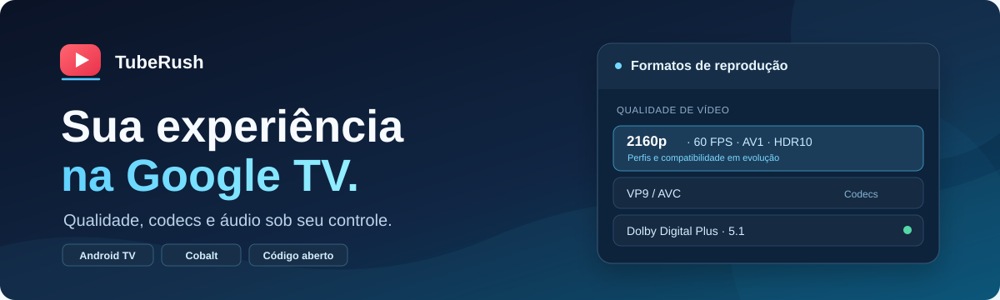

  

<h1 align="center">TubeRush</h1>

  <strong>YouTube na TV, do seu jeito.</strong>

  Android TV / Google TV · Cobalt 27 LTS · 4K / HDR · Áudio 5.1

  <a href="https://github.com/HeliumMarcos/TubeRush/releases/latest"><strong>Baixar APK</strong></a> ·
  <a href="#instalação">Instalação</a> ·
  <a href="#recursos">Recursos</a> ·
  <a href="docs/TUBERUSH_PLANO_MESTRE.md">Plano de melhorias</a> ·
  <a href="#documentação">Documentação</a>

O **TubeRush** é uma versão alternativa do YouTube para Android TV / Google TV, baseada no [TizenTubeCobalt](https://github.com/reisxd/TizenTubeCobalt) e no motor [Cobalt](https://github.com/youtube/cobalt). O projeto busca ampliar o controle sobre **resolução, codec, HDR, taxa de bits e faixas de áudio**, mantendo uma interface adequada ao controle remoto da TV.

> **Estado atual:** versão **v1.0.0 experimental**. Há recursos de vídeo 4K e áudio multicanal integrados à base atual, mas ainda existem correções e testes de compatibilidade pendentes. A presença de um formato no menu **não garante** sua reprodução em todos os dispositivos.

## Instalação

1. Abra a [release mais recente do TubeRush](https://github.com/HeliumMarcos/TubeRush/releases/latest).
2. Para dispositivos Android compatíveis com **ARMv7**, baixe o arquivo **`TubeRush-v1.0.0-armeabi-v7a.apk`** na release v1.0.0, ou o APK correspondente à arquitetura indicado em versões futuras.
3. Instale o APK na TV, utilizando um gerenciador de arquivos ou ADB e autorizando a instalação pelo Android quando solicitado.
4. Abra o **TubeRush** e configure preferências de vídeo e áudio. Consulte as limitações e testes em andamento antes de considerar um formato garantido.

**Atualização pelo aplicativo:** a consulta e instalação de novas versões diretamente pelos Releases do TubeRush estão **planejadas**, mas não são anunciadas aqui como recurso pronto. No momento, use as [Releases](https://github.com/HeliumMarcos/TubeRush/releases) para consultar novas versões.

## Recursos

| Área | O que o TubeRush oferece ou está aperfeiçoando | Situação |
| --- | --- | --- |
| **Vídeo 4K / HDR** | Descoberta e reprodução com AV1, VP9 e AVC; identificação de resolução, FPS, HDR e bitrate | Em validação |
| **Menu de qualidade** | Listagem por representação, sem ocultar codecs ou resoluções pela preferência global | Correções planejadas |
| **Preferências e fallback** | Priorizar a resolução e o codec configurados, sem travar quando o formato não existe | Correções planejadas |
| **Áudio surround** | Dolby Digital Plus (E-AC-3) e Dolby Digital (AC-3) 5.1, quando disponíveis e compatíveis | DD+ testado; troca de faixas em validação |
| **Idiomas e faixas** | Faixas de áudio distintas por idioma, canais e codec, sem perder opções | Correções planejadas |
| **Bitrates elevados** | Pesquisa de representações HLS/DASH/SABR, incluindo VP9 4K60 acima de 100 Mbps anunciado pelo YouTube | Investigação e teste pendentes |
| **Atualização** | Consultar, baixar e instalar APKs pelos próprios GitHub Releases | Planejado |

As funções herdadas do projeto original incluem integrações como **SponsorBlock**, **DeArrow**, controles de reprodução e bloqueio de anúncios, sujeitas à compatibilidade com o aplicativo do YouTube TV.

<strong>O que são Cobalt, ITAG e bitrate?</strong>

- **Cobalt** é o motor usado para executar a experiência web do YouTube TV em dispositivos incorporados, como televisores e set-top boxes.
- **ITAG** é um identificador de representação de mídia; formatos também diferem por protocolo, cliente, faixa de idioma e perfil de codec.
- **Bitrate anunciado** é o valor disponibilizado pela origem/manifesto; não é necessariamente o bitrate médio real da reprodução nem a velocidade da conexão.

## Compatibilidade e testes

O principal ambiente de validação é uma **TCL C7K com Android/Google TV e soundbar LG S95TR**. A confirmação de **Dolby Digital Plus 5.1** nesse conjunto não implica suporte universal a qualquer outro televisor ou saída de áudio.

A auditoria usa cinco vídeos de referência para verificar: qualidade **4K60** e HDR10, alternância **DD+ ↔ DD 5.1**, áudio em múltiplos idiomas, fallback sem 2160p e uma representação **HLS VP9 4K60** de aproximadamente **115,68 Mbps anunciados**. A reprodução efetiva desse último formato ainda depende de verificação no Cobalt.

A matriz de testes, os arquivos afetados e os critérios de aceitação estão no **[Plano Mestre de Correções e Melhorias](docs/TUBERUSH_PLANO_MESTRE.md)**.

## Documentação

| Preciso de… | Abrir |
| --- | --- |
| Consultar todas as correções, prioridades e os cinco relatórios de vídeo | [Plano mestre do TubeRush](docs/TUBERUSH_PLANO_MESTRE.md) |
| Entender a arquitetura de reprodução | [Arquitetura Cobalt/Android](docs/l1-playback-architecture.md) |
| Conferir as capacidades de mídia e os pontos de integração | [Auditoria de mídia](docs/l1-media-capabilities.md) |
| Acompanhar a atualização futura do motor Cobalt | [Avaliação de upgrade](docs/l1-cobalt-upgrade-assessment.md) |
| Entender como organizar a raiz em sete entradas sem quebrar o Cobalt | [Organização da raiz](docs/TUBERUSH_ORGANIZACAO_RAIZ.md) |
| Ver código-fonte, mudanças e APKs | [Código](https://github.com/HeliumMarcos/TubeRush) · [Releases](https://github.com/HeliumMarcos/TubeRush/releases) |
| Relatar erros ou sugerir melhorias | [Issues](https://github.com/HeliumMarcos/TubeRush/issues) |

## Desenvolvimento

**Estrutura em teste na branch `refactor/seven-entry-root`:** o código Chromium/Cobalt foi movido para `app/`, deixando apenas sete entradas na raiz. **O checkout e a montagem temporária da árvore Cobalt foram validados no Actions; a compilação completa ainda não foi confirmada. O `main` permanece inalterado.** Consulte os [riscos e verificações pendentes](docs/TUBERUSH_ORGANIZACAO_RAIZ.md).

- **Código e integração nesta branch:** `app/cobalt/`, `app/starboard/`, `app/third_party/`, `app/.gn` e `app/DEPS`.
- **Compilação Android:** `.github/workflows/l1-android-armv7-build.yml`.
- **Plano de execução:** `docs/TUBERUSH_PLANO_MESTRE.md`.
- **Instruções para agentes e contribuidores:** `AGENTS.md`.
- **Migração de estrutura:** [teste de checkout aprovado](https://github.com/HeliumMarcos/TubeRush/actions/runs/43374563065); ainda não substitui uma compilação Android.
- **Submódulos:** `.gitmodules` na raiz aponta para `app/` e `docs/website`; `app/.gitmodules` preserva os caminhos originais do Cobalt.

## Créditos e licenças

**TubeRush** é uma personalização independente desenvolvida a partir de projetos de código aberto. Os créditos de [reisxd/TizenTubeCobalt](https://github.com/reisxd/TizenTubeCobalt), [TizenTube](https://github.com/reisxd/TizenTube), [YouTube Cobalt](https://github.com/youtube/cobalt), Chromium e demais componentes continuam pertencendo aos respectivos autores. Consulte os arquivos de licenças e avisos incluídos no código, como [LICENSE](app/LICENSE), [AUTHORS](app/AUTHORS) e os avisos específicos das dependências. O TubeRush não é um aplicativo oficial do YouTube ou do Google.
