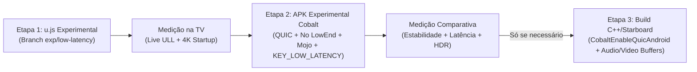

# Plano Experimental: Baixa Latência em Lives, Qualidade Rápida e Estabilidade (TCL C7K)

Este documento detalha o plano em etapas para criar e validar uma **versão experimental separada** do **TizenTube L1**, focada em:
1. Reduzir ao máximo o atraso em **transmissões ao vivo** sem causar travamentos (rebuffering).
2. Eliminar a necessidade de **acelerar o vídeo manualmente** para alcançar o "ao vivo" (**Auto-Catch-Up** inteligente).
3. Acelerar o carregamento inicial e a subida para a **melhor qualidade de vídeo e áudio** logo nos primeiros segundos.

> [!IMPORTANT]
> **Regra de isolamento:** todo o desenvolvimento experimental ocorrerá em uma **branch separada** (ex.: `exp/low-latency` e CDN dedicada), mantendo a branch `main` e a release oficial `v2.0.3-c7k-l1` 100% intactas e estáveis.

---

## 1. Análise do Sistema Atual (Baseline Medido)

| Camada | Estado Atual (`main` / `v2.0.3-c7k-l1`) | Gargalo Identificado |
| :--- | :--- | :--- |
| **Hardware / OS** | TCL C7K — MediaTek **MT5896** (Pentonic 700), **Android 14**, ABI `armeabi-v7a` | Hardware suporta 4K60 AV1/VP9 e até 8K60, mas o Cobalt o trata como dispositivo *low-end*. |
| **Motor / APK** | Google Cobalt **27.lts.10** (`qa`), `StarboardRenderer` + `MediaCodec` + `AudioTrackBridge` | Build `qa` é rápida na UI, porém flags padrão do Cobalt limitam rede e memória. |
| **Rede (Cobalt Java/C++)** | `JavaSwitches.java` injeta `--disable-quic` por padrão; `configuration.cc` retorna `CobaltEnableQuicAndroid() = false` | Tudo trafega em **TCP/TLS** sem **HTTP/3 (QUIC)**, sofrendo mais com perda de pacotes / *head-of-line blocking* em Wi-Fi. |
| **Memória / Pipes (Cobalt)** | `--enable-low-end-device-mode` e `--force-gpu-mem-available-mb=64` ativos por padrão | Limita buffers de mídia, pipes Mojo e cache de rede/GPU muito abaixo da capacidade real da C7K. |
| **Decodificador (`MediaCodec`)** | `c2.mtk.av1.decoder` / `c2.mtk.vp9.decoder` configurados sem `KEY_LOW_LATENCY` | Driver MediaTek pode reter frames na fila interna esperando *B-frames* futuros. |
| **Player Web (`tv-player-es6.js`)** | `yt-player-proxima-pref` desligado; sem auto-catch-up de `playbackRate` após quedas; `lbw` inicial medido baixo (~4,5–7,5 Mbps nos primeiros instantes) | Lives acumulam 10–40s de atraso após qualquer micro-oscilação e o usuário precisa acelerar manualmente; vídeos iniciam em 720p/1080p antes de subir para 4K quando `lbw` sobe. |

> [!NOTE]
> **"Zero delay" realista em HTTP/SABR:** em streaming adaptativo (SABR/DASH), atraso literal de `0.0s` é fisicamente impossível por conta do tempo de codificação, CDN e de um buffer mínimo de segurança. O objetivo realista sem engasgos em lives elegíveis (ULL/Low-Latency) é **~1,5s a 3,0s** estáveis na borda, com retorno automático caso ocorra qualquer oscilação.

---

## 2. Arquitetura em Etapas

---

## 3. Etapa 1 — Camada Web / SABR (`u.js` Experimental)

**Escopo:** alterações exclusivas em JavaScript no `u.js` da branch experimental (`exp/low-latency`), carregadas pelo APK experimental sem precisar recompilar o binário C++.

### 3.1. Ativação do modo oficial "Proxima" / Ultra-Low Latency do YouTube
No `tv-player-es6.js`, o player suporta nativamente redução de fila de chunks e de desvio permitido em lives elegíveis via `Proxima`:
- Definir `yt-player-proxima-pref = 1` no `localStorage` quando não configurado manualmente.
- Reforçar em `playerConfig` / `yt.config_.EXPERIMENT_FLAGS` (quando o stream for ao vivo / `isLive`):
  - `html5_enable_proxima: true`
  - `html5_sabr_force_proxima: true`
  - `html5_sabr_live_ultra_low_latency_streaming_xhr: true`
  - `html5_ultra_low_latency_subsegment_readahead: true`
  - `html5_live_chunk_readahead_proxima_override`: testar valor conservador vs agressivo (`1` ou `2` chunks).
  - `html5_liveness_drift_proxima_override`: reduzir o limite de drift tolerado antes de o player tentar corrigir.
  - `html5_min_startup_buffered_media_duration_for_live_secs`: testar `0.15`–`0.25`s para play quase imediato em lives.

### 3.2. Controlador Inteligente de Auto-Catch-Up (Somente em Lives)
Substitui a necessidade de acelerar manualmente o vídeo quando a transmissão perde sincronia com o tempo real:
- **Detecção estrita de Live:** só ativa quando `player.getVideoData()?.isLive` (e usuário não estiver assistindo trecho antigo/DVR pausado manualmente longe da borda, e não tiver escolhido velocidade customizada fora de `1.0x`).
- **Leitura de métricas em tempo real** (via `player.getDebugText(true)` / estado interno e elemento `<video>`):
  - `rawlivelatency` / `livelatency` (atraso atual até a borda)
  - `bufferHealth` (`vbu` / `video.buffered.end - currentTime`)
- **Política adaptativa por zonas:**
  - **Zona de segurança (`bufferHealth < 0.8s`):** mantém ou retorna imediatamente para **`1.00x`** para evitar travamento/rebuffering.
  - **Na borda (`latência <= alvo`, ex.: `<= 2.2s`):** mantém **`1.00x`**.
  - **Levemente atrasado (`2.2s < latência <= 6.0s` e `bufferHealth >= 1.2s`):** acelera discretamente entre **`1.04x` e `1.10x`** (pitch preservado pelo Chromium, praticamente imperceptível no áudio) até encostar no alvo.
  - **Atraso moderado (`6.0s < latência <= 15.0s` e `bufferHealth >= 1.5s`):** acelera entre **`1.12x` e `1.20x`** até retornar à borda e volta para `1.00x`.
  - **Atraso severo (`> 15.0s` mantendo flag `isAtLiveHead` ou modo auto-borda):** opção de salto direto (`player.seekTo(Infinity, true)`) com cooldown para não entrar em loop se a rede estiver lenta.
- **Preservação de VOD:** em vídeos normais (não ao vivo), o controlador fica **100% desligado**, respeitando a velocidade escolhida pelo usuário.

### 3.3. Entrega Inicial Mais Rápida de Vídeo e Áudio
- **Pré-aquecimento de rede (`<link rel="preconnect">` / `dns-prefetch`):** injetar no bootstrap para `https://*.googlevideo.com`, `https://youtubei.googleapis.com` e `https://i.ytimg.com`, economizando handshake DNS/TLS antes do usuário clicar em um vídeo.
- **Pré-aquecimento da estimativa de banda (`yt-player-bandwidth`):** se o valor salvo estiver ausente ou abaixo de um piso razoável na primeira abertura, semear um valor inicial realista (ex.: compatível com 4K quando a conexão responder rápido) e reduzir `html5_min_startup_buffered_media_duration_secs` para acelerar o primeiro frame.
- **Preferência segura de áudio/vídeo:** manter todas as resoluções e áudios (`opus`, `ec-3`, `aac`), sem quebrar `CP.BITRATE` (`2E9`) nem o `maxBitrateBps` do SABR.

### Critérios de Teste da Etapa 1
Testar na TV (`192.168.31.75:5555`) em:
- 2 lives com chat ativo (uma em 1080p60 / ULL e outra em 4K ou 1080p normal), medindo por 5 minutos:
  - `rawlivelatency` inicial e após 5 min;
  - `bufferhealth` mínimo e contagem de stalls/rebuffering;
  - Se o `playbackRate` volta suavemente a `1.00x` sem engasgos de áudio;
- 2 vídeos VOD (1 vídeo 4K60 HDR e 1 vídeo 1080p), medindo tempo até o primeiro frame, resolução inicial e ausência de erros.

---

## 4. Etapa 2 — Flags Nativas do Cobalt Android (APK Experimental)

**Escopo:** criar um pacote experimental paralelo (ex.: `TizenTube L1 Exp`, para não substituir nem o original nem o `TizenTube L1` estável) aplicando destravamentos no código Java/Manifest do Cobalt:

1. **Habilitar QUIC / HTTP/3 (`EnableQUIC`):**
   - Remover a injeção automática de `--disable-quic` em `JavaSwitches.java` (passar `EnableQUIC` em `mJavaSwitches`) e validar via DevTools/netlog se as conexões `googlevideo.com` passam a negociar `h3` (QUIC) com menor jitter.
   - *Fallback obrigatório:* validar na rede local se UDP/QUIC não sofre throttling ou perda no roteador/ISP.
2. **Desativar `--enable-low-end-device-mode` e liberar memória na MT5896:**
   - Passar `DisableLowEndDeviceMode` em `JavaSwitches.java`.
   - Elevar `ForceGpuMemAvailableMb` de `64` MB para `256` MB e ajustar `--js-flags=--max-old-space-size=768` / cache HTTP.
3. **Aumentar pipes Mojo de mídia e bypass do agendador conservador:**
   - Ativar via `cobalt.ENABLE_FEATURES` / `JavaSwitches`:
     - `CobaltDynamicMojoPipeSizing` com `media_size` e `subresource_size` ampliados.
     - Testar `CobaltBypassResourceLoadScheduler` para evitar retenção artificial de requisições de chunks de áudio/vídeo.
4. **`MediaFormat.KEY_LOW_LATENCY` no `MediaCodec` (Android 14):**
   - Testar no `MediaFormatBuilder.java` / `MediaCodecBridge.java` a inclusão de `MediaFormat.KEY_LOW_LATENCY = 1` (verificando antes via `CodecCapabilities.isFeatureSupported("low-latency")` no `c2.mtk.*`).
   - Validar cuidadosamente em **4K60 HDR** (`CrW2wrMcCzQ` / `MNsbPClRgyg`) e **Lives 60fps** para confirmar zero artefatos, zero *frame drops* e redução real de atraso na fila do decodificador MediaTek.

---

## 5. Etapa 3 — Build Nativo C++ / Starboard (Opcional, se necessário)

Somente executada caso as Etapas 1 e 2 apontem gargalo na camada C++:
- Alterar `CobaltEnableQuicAndroid()` para `return true;` em `starboard/android/shared/configuration.cc`.
- Revisar limites de cache HTTP, buffer de áudio no `AudioTrackBridge` / `StarboardRenderer` e `media_capabilities_cache.cc` em compilação **`qa`** completa (nunca `-devel`).

---

## 6. Ordem de Execução Recomendada

1. **Criar branch experimental** no repositório (ex.: `exp/low-latency` + tag/branch CDN dedicada) mantendo `main` intocada.
2. **Executar e validar Etapa 1 (`u.js` experimental)** diretamente na TV com métricas antes/depois em lives reais.
3. **Executar e validar Etapa 2 (APK experimental com QUIC + remoção de low-end-mode + pipes Mojo + teste de `KEY_LOW_LATENCY`)** apenas após estabilizar a Etapa 1.
4. **Promover para `main` somente o que comprovar ganho sólido sem regressões.**
